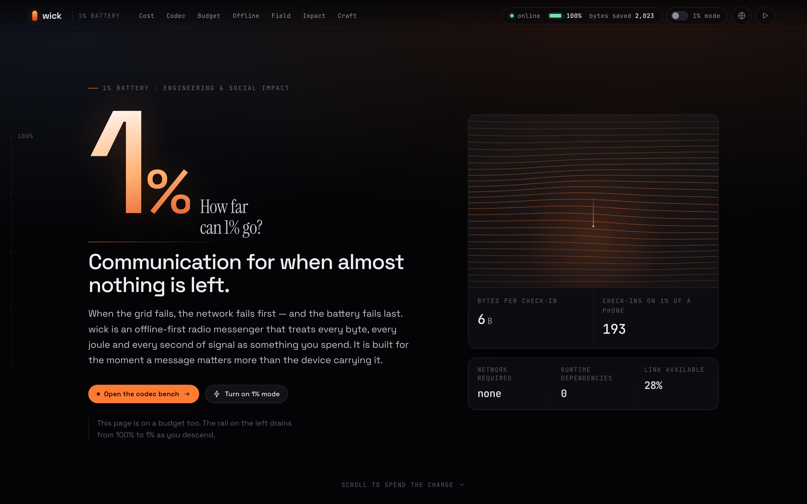

# wick — 为只剩 1% 的世界而造的通信工具

**主题：1% Battery　赛道：Engineering & Social Impact**



> **电网一断，网络最先死，电量最后死。**
> wick 是一个离线优先的无线电通信工具：它把每一个字节、每一焦耳、每一秒信号都当作要花出去的钱。

**它让最后 1% 的电量说出最有用的那句话。** 一条报到帧 **6 字节**，密封后 **31 字节**——保密是明码标价的 25 字节；5 种无线电按「**还能送达几条**」排名，而不是按吞吐率；没有链路时消息落进设备队列，链路一回来整个队列一次传出去。

手写编解码、手写 ChaCha20-Poly1305（对照 RFC 8439 官方向量）、零运行时依赖、零网络字体。纯静态、零构建、零后端——打开就能用，**关掉网络还能用**。

| 项目状态 | |
| --- | --- |
| 内核测试 `tests/codec.test.html` | **58 passed · 0 failed** |
| 整页集成测试 `tests/page.test.html` | **25 passed · 0 failed** |
| 离线外壳测试 `tests/offline.test.html` | **7 passed · 0 failed**（需真实浏览器） |
| 运行时依赖 / 第三方网络请求 | **0 / 0**（字体自托管，无 CDN） |
| 关键路径体积 | 188 KB（gzip）· 去掉字体 101.8 KB · **1% 模式 0 字体字节** |

```bash
python3 -m http.server 8000     # 然后打开 http://localhost:8000
```

没有 `npm install`，没有构建步骤，没有后端。

**在线预览**（静态镜像，评委请以仓库内源码为准）：<https://wick-one-percent.app.workbuddy.host/>

> 全文 15 节，按「问题是什么 → 怎么跑 → 做了什么 / 没做什么 → 怎么做的 → 可复算的证据」排列。
> 时间有限的读者建议按 **1 → 2 → 3 → 4 → 9 → 10** 的顺序看；第 4 节是如实标注的未实现清单，第 9、10 节是实测体积与测试证据。

---

## 1. 一句话说明

主流聊天软件为了说一句「我安全」，在你这句话被送达之前就已经花掉了几百个字节。wick 换掉了这套做法：**126 个应急通信真正会用到的词，各占一个字节**；位置以已知原点为基准做 11 米精度的差分；一个 CRC-8 随帧同行。于是同一句话从 254 字节的信封变成 6 字节的帧。

真要说位置，那就不能是明文。wick 因此在帧上再叠一层 **ChaCha20-Poly1305**（RFC 8439）：**保密的价格是 25 个字节**——1 字节算法标识、8 字节随机数后缀、16 字节认证标签。6 字节的报到帧密封后是 31 字节，仍比 354 字节的聊天信封小 11 倍。第 02 节把这张收据逐项打出来，并且可以当场伪造一个标签看它被拒绝。

然后——这才是关键——wick 让**每条消息都知道自己有多贵**，并给出一个可以当场演示的电量预算引擎：输入剩余电量与网络制式，它算出你还能发多少条、撑多久。在 1% 的电量下，这个问题的答案决定了你能做多少事。

**这个网站本身也在演示同一件事。** 页面左侧有一条随滚动从 100% 掉到 1% 的「能量轨」；顶栏常驻遥测（电量、信号、已省字节、帧耗时）；并且有一个真实可切换的 **1% 模式**——它会把网站自己剥到只剩核心：不加载任何字体、去掉颗粒与辉光、关闭全部动效、退回系统字体与单色。媒介本身在演示论点，而不只是陈述它。

不知道从哪里看起的话，顶栏的 ▶ 按钮或 `?demo=1` 会打开一个**七步引导演示**，每一步把你带到对应分区并说明该做什么。

---

## 2. 五分钟跑起来

需要一个静态文件服务器（Service Worker 要求 http:// 或 https://）：

```bash
cd wick
python3 -m http.server 8000
# 打开 http://localhost:8000
```

没有依赖、没有 npm install、没有构建步骤。任何静态托管（GitHub Pages / Gitee Pages / Nginx / Vercel）直接上传本目录即可。

**离线验证（建议当场做）**：打开页面 → 关掉 Wi-Fi → 刷新。页面会回来，发件队列还在，第 04 节的 `service worker: active · shell cached` 依然亮着。

这条不是「应该能行」，它有一条会在真实浏览器里跑的测试：`tests/offline.test.html`。它把页面装进一个**有真实 URL 的同源 iframe**（Service Worker 无法在 `document.write` 出来的文档里注册），等待 worker 激活，然后直接问它自己的缓存清单。实测输出：

```
scope /                                  ← 已注册，作用域覆盖整站
activated · active                       ← 已激活
{"version":"wick-v2","total":48,"cached":48,"missing":[],"failed":[]}
第 04 节显示：active · shell cached · 48/48
```

第 04 节的标签只在**拿到 worker 自报的完整清单之后**才会变成 `active · shell cached`；拿不到清单时它显示 `registered · cache unconfirmed`，环境不支持时显示 `unavailable in this context`。一个页面不应该把「已缓存」写在没有任何证据的地方。

### 可直接深链的状态

| 链接 | 作用 |
| --- | --- |
| `?mode=eco` | 以 1% 模式打开（不请求任何字体字节） |
| `?lang=zh` / `?lang=en` | 直接以中文或英文打开 |
| `?still=1` | 关闭入场动效（截图与打印用；顶栏隐藏未测得的帧耗时） |
| `?demo=1` | 打开七步引导演示 |

---

## 3. 赛题对应关系

命题给出的三个方向，各对应一个可演示、可量化的支柱：

| 赛题提示词 | wick 的对应实现 | 现场怎么演示 |
| --- | --- | --- |
| 极限优化 / 更少资源 | 自研编解码：字典词元 + varint/zigzag + 位置与时间差分 + 6-bit 文本打包 + CRC-8 | 第 02 节输入任意消息，实时看十六进制帧、字段归属、字节数与能耗；点「压测 20 000 帧」看每帧耗时 |
| 离线与弱网应用 | Service Worker 预缓存 + IndexedDB 发件队列 + store-and-forward 合批 | 第 04 节切到「No link」撰写若干条，再切回弱网，看整个队列一次传出去 |
| 资源模拟 | 电量预算引擎：5 种无线电 × 5 种能量来源，按「还能发几条」排序 | 第 03 节拖动电量滑杆、换无线电、开 1% 模式，读三个数字；第 05 节跑 4 个场景的时间推演 |
| 安全与隐私边界 | `src/core/cipher.js` 里的 ChaCha20-Poly1305（RFC 8439）+ `src/core/secure.js` 的密封帧格式、计数器与防重放 | 第 02 节下半：点「密封这一帧」看 25 字节的收据，点「改动校验标签里的一个比特」看伪造帧被拒绝 |

---

## 4. 功能实现状态（如实标注）

规则要求 README 里写的功能必须在代码里存在。下表每一项都给出可核对的文件；**未实现的部分单独列出，不做美化**。

### 已实现

| 功能 | 状态 | 证据文件 |
| --- | --- | --- |
| 自研二进制编解码（encode/decode/measure） | ✅ 已实现 | `src/core/codec.js` |
| 位级打包、varint、zigzag、CRC-8 | ✅ 已实现 | `src/core/bits.js` |
| 126 词字典 + 6-bit 文本打包（含转义） | ✅ 已实现 | `src/core/dictionary.js` |
| 位置差分编码（1/10000 度 ≈ 11 米） | ✅ 已实现 | `src/core/codec.js` |
| 消息类型：check-in / need / sitrep / ack / beacon | ✅ 已实现 | `src/core/codec.js` |
| 帧完整性校验与坏帧拒绝 | ✅ 已实现 | `src/core/bits.js` + 测试用例 |
| 往返校验（编码→解码→比对）实时显示 | ✅ 已实现 | `src/ui/bench.js` |
| 对称加密：ChaCha20-Poly1305（RFC 8439） | ✅ 已实现 | `src/core/cipher.js`（对照 RFC §2.3.2/§2.4.2/§2.5.2/§2.8.2 官方向量） |
| 密封帧格式：算法标识 + 随机数后缀 + 认证标签（25 B 开销） | ✅ 已实现 | `src/core/secure.js` |
| 防重放（单调消息计数器）与伪造帧拒绝 | ✅ 已实现 | `src/core/secure.js` + 第 02 节交互 |
| 主流聊天软件信封基线（可审计，见第 8 节） | ✅ 已实现 | `src/core/baseline.js` |
| 5 种无线电 × 5 种能量来源的能耗模型 | ✅ 已实现 | `src/core/energy.js` |
| 电量预算引擎（可发条数 / 可维持时间 / 固定 vs 按字节拆分） | ✅ 已实现 | `src/core/budget.js` |
| 无线电按「送达条数」排名 | ✅ 已实现 | `src/core/budget.js` + `src/ui/lab.js` |
| 1% 模式（产品层：舍弃位置/时间/文采） | ✅ 已实现 | `src/core/budget.js`（`ECO_TRIMMING`） |
| 1% 模式（页面层：不加载字体、去动效、退系统字体） | ✅ 已实现 | `src/ui/settings.js` + `assets/css/motion.css` |
| Service Worker 预缓存整套外壳 | ✅ 已实现 | `sw.js`（逐条 `put`，失败条目可读回）+ `src/main.js` 注册；实测 48/48 |
| 离线状态如实上报（不谎报「已缓存」） | ✅ 已实现 | `src/ui/offline.js` 的 `reportWorkerState()`，三种状态 + 缓存条目数 |
| IndexedDB 本地发件队列（含内存降级） | ✅ 已实现 | `src/core/store.js` |
| store-and-forward 合批发送与自动冲刷 | ✅ 已实现 | `src/core/sync.js` + `src/ui/offline.js` |
| 逐分钟现场推演（4 个场景，确定性随机种子） | ✅ 已实现 | `src/core/sim.js` |
| 结果导出为 PNG 成绩卡（本机 canvas 绘制，无上传） | ✅ 已实现 | `src/ui/sharecard.js` |
| 七步引导演示（`?demo=1`，键盘可操作） | ✅ 已实现 | `src/ui/tour.js` |
| 图表的数据表版本（`<details>` 内，供屏幕阅读器与导出） | ✅ 已实现 | `src/ui/field.js` + `assets/css/app.css` |
| Web Worker 承载批量编码与场景推演 | ✅ 已实现 | `src/workers/codec.worker.js`、`src/workers/sim.worker.js` |
| 中英双语（全站文案，含技术说明与中文术语对照） | ✅ 已实现 | `src/ui/lang/en.js`、`src/ui/lang/zh.js` |
| 无障碍：键盘可达、可见焦点、跳转链接、reduced-motion、无脚本可读、图表数据表 | ✅ 已实现 | `assets/css/base.css`、`src/ui/reveal.js` |
| 内核测试与整页集成测试 | ✅ 已实现 | `tests/codec.test.html`（58 项）、`tests/page.test.html`（25 项） |
| 离线外壳的端到端测试 | ✅ 已实现 | `tests/offline.test.html`（7 项，需在真实浏览器里跑） |
| 启动自检：任一模块挂载失败不影响整页，失败清单可读 | ✅ 已实现 | `src/main.js` → `window.__wick` |
| 真实运行截图（脚本可复现） | ✅ 已实现 | `tools/shoot-screenshots.py` → `screenshots/` |
| 体积预算表取自真实文件 | ✅ 已实现 | `tools/build-budget-data.py` → `src/ui/budget-data.js` |
| 打包时校验自身一致性（SHELL / 引用 / 引导模块） | ✅ 已实现 | `tools/pack.py` 的 `verify()` |

### 未实现 / 有意不做（不计分，但如实声明）

| 项目 | 状态 | 说明 |
| --- | --- | --- |
| 真实无线电硬件接入（LoRa / BLE / 蜂窝模块） | ❌ 未实现 | 本作品是 Web 原型：编解码、加密、能耗模型与调度逻辑是真的，**传输层是模拟的**。没有真实射频驱动。 |
| 密钥交换协议 | ❌ 未实现 | 加密算法与帧格式是真的并且有测试；**密钥怎么到对方手里没有实现**——代码里的会话密钥由用户在离线渠道（扫码或口头短码）自行约定，第 02 节用的是印在页面上的演示密钥。真实部署还需要一个密钥协商/轮换流程。 |
| 多设备同步 / 服务器 | ❌ 未实现 | 没有后端。发件队列是单设备的。 |
| BLE 逐跳中继（mesh 转发） | ❌ 未实现 | 第 06 节描述了这个场景，但代码里没有实现多跳转发协议。 |
| 真实地图数据 / 地理围栏 | ❌ 未实现 | 位置只是数字坐标，没有地图瓦片，也不声称任何覆盖范围。 |
| 硬件实测能耗 | ❌ 未实现 | 能耗系数是基于公开测量与典型占空比的**估算**，不是仪器读数。 |
| 恒时（constant-time）实现的完整审计 | ⚠️ 部分 | 标签比较是无分支的恒时比较；但整个实现没有做过侧信道审计，也没有做过第三方密码学评审。这是「能用」与「可交付」之间的距离，写在明面上。 |
| 账号、推送、分析埋点 | ❌ 有意不做 | 与主旨冲突，也不符合内容与安全边界。 |

---

## 5. 核心文件清单

```
wick/
├── index.html                     单页结构（全部文案走 data-i18n）
├── sw.js                          Service Worker：预缓存整套外壳，真离线
├── manifest.webmanifest           可安装
├── assets/
│   ├── css/tokens.css             设计令牌（含 1% 模式的降级令牌）
│   ├── css/base.css               重置、排版、顶栏、能量轨、按钮与控件
│   ├── css/app.css                七个分区的版式
│   ├── css/motion.css             动效 + 1% 模式与 still 的动效剥离
│   ├── css/fonts.css              自托管字体声明（仅完整模式请求）
│   ├── fonts/*.woff2              Space Grotesk / JetBrains Mono / Instrument Serif（拉丁子集，OFL）
│   └── icon.svg
├── src/
│   ├── main.js                    引导：注册离线外壳、逐模块启动、单个模块失败不影响整页
│   ├── core/                      纯逻辑，无 DOM，可在 Worker 与测试页复用
│   │   ├── bits.js                位打包、varint、zigzag、CRC-8、定点坐标
│   │   ├── dictionary.js          126 词字典 + 6-bit 字母表
│   │   ├── codec.js               编解码、分词、往返校验、measure()
│   │   ├── cipher.js              ChaCha20-Poly1305（RFC 8439），对照官方向量
│   │   ├── secure.js              密封帧格式、会话计数器、防重放
│   │   ├── baseline.js            主流聊天软件信封与逐制式封帧（可审计的对照）
│   │   ├── energy.js              无线电与电池模型（系数明确标注为估算）
│   │   ├── budget.js              消息规划、对比、无线电排名、1% 裁剪
│   │   ├── store.js               IndexedDB（含超时与内存降级）
│   │   ├── sync.js                Outbox：排队、合批、冲刷
│   │   └── sim.js                 逐分钟现场推演（确定性种子）
│   ├── ui/                        渲染层：每个模块只负责一个分区
│   │   ├── i18n.js + lang/*.js    中英文案与绑定
│   │   ├── settings.js            1% 模式与语言（可深链，持久化）
│   │   ├── state.js               共享状态（第 02 与第 03 节共用同一条消息）
│   │   ├── telemetry.js           顶栏遥测、能量轨、真实帧耗时
│   │   ├── reveal.js              入场节奏与当前分区标记
│   │   ├── hero.js                烛焰场（Canvas）与首屏读数
│   │   ├── cost.js                第 01 节：字节解剖与合批滑杆
│   │   ├── bench.js               第 02 节：编解码实验台（含十六进制帧）
│   │   ├── seal.js                第 02 节下半：密封帧与 25 字节的收据
│   │   ├── lab.js                 第 03 节：电量预算实验室
│   │   ├── offline.js             第 04 节：真实发件队列与链路切换
│   │   ├── field.js               第 05 节：场景推演、图表与数据表
│   │   ├── sharecard.js           第 05 节：结果导出为 PNG 成绩卡
│   │   ├── tour.js                七步引导演示（`?demo=1`）
│   │   ├── impact.js              第 06 节：网络示意图与情境卡片
│   │   ├── craft.js               第 07 节：实现说明
│   │   ├── craft-data.js          第 07 节的静态事实
│   │   └── budget-data.js         ← 由 tools/build-budget-data.py 生成（勿手改）
│   └── workers/
│       ├── codec.worker.js        批量编码
│       └── sim.worker.js          场景推演
├── tests/
│   ├── codec.test.html            内核测试：58 项断言
│   ├── page.test.html             整页集成测试：25 项断言
│   └── offline.test.html          离线外壳端到端测试：7 项断言（需真实浏览器）
├── tools/
│   ├── build-budget-data.py       量取真实文件体积并生成体积表
│   ├── shots.html                 截图夹具（按分区、元素或精确尺寸渲染真页面）
│   ├── shoot-screenshots.py       重新生成 screenshots/ 与 screenshots/extra/
│   └── pack.py                    打包提交版本（zip），并校验自身引用一致性
├── screenshots/                   8 张提交截图 + extra/ 5 张补充（见 screenshots/README.md）
│   └── extra/                     补充材料，不计入提交集合
├── HANDOFF.md                     交接文档：不可破坏的约束、欠账清单、自检脚本
├── AI_USAGE.md                    AI 使用说明
├── ai-logs/                       AI 对话记录
├── CREDITS.md                     字体、标准、资料与工具致谢
└── DEMO.md                        3 分钟演示脚本
```

---

## 6. 关键设计决策与技术取舍

规则要求参赛队说明关键设计与取舍——包括**做得不好的地方**。以下按重要性排列。

### 6.1 不做通用压缩，改成「不给它东西压」

**取舍**：wick 牺牲了表达的完整自由度。字典外的每个字符都要落到 6-bit 打包（4 字符 3 字节），大写与多余空格在传输时被规范化。

**为什么值得**：应急通信的语料极度重复。实测「need water and medical at sector 4」有 79% 的字符落在字典内。用 6 bit/字符换掉 8 bit/字符，再叠上词元替换，收益远大于损失。代价是**解码端看到的是小写、单空格的规范化文本**——这一条写在界面上，不藏在代码里。

### 6.2 固定成本才是主战场，而它只能靠合批解决

**取舍**：合批提高了时延。一条消息可能要在设备上多待几十秒，直到队列攒够或链路出现。

**为什么值得**：蜂窝无线电每次传输要付一次唤醒/RRC/Tail 成本（模型里 LTE 为 1.4 J/次）。这个成本与消息长度几乎无关。因此：

- 单条 LTE 上，wick 帧 6 B + 传输层 61 B = 67 B，对比主流 354 B → **5.3×**
- 合批 8 条后，摊薄为 13.6 B/条 对比 266.5 B/条 → **19.6×**
- 在无 IP 封帧的原始无线电（LoRa/BLE）上，优势回到帧本身 → **42×**

三个数字都写在页面上，滑杆可以当场验证。**我们选择把这条时延取舍摆在明面上**，因为「离线优先」本来就意味着接受延迟换取送达率。

### 6.3 位置用差分，且接受 11 米精度

**取舍**：11 米意味着无法用于楼层级定位，且必须与对端共享一个会话原点。

**为什么值得**：搜救是网格化的。知道「第 4 区」比知道「第 4 区东侧第三扇窗」有用得多，而后者要额外几十个字节。以会话原点为基准做 zigzag varint 差分，600 米内每轴只要 1 字节。**当原点未共享时，第一帧会退化为较长的绝对编码**——这个退化在代码里是显式的。

### 6.4 1% 模式是一次产品取舍，不是一次优化

**取舍**：在 1% 模式下，wick 主动**放弃位置、时间与自由文本**，只保留一个字典词元。

**为什么值得**：知道「你需要水」的接收者可以行动；知道「你三分钟前在哪儿」的接收者往往不能。把这条取舍写成代码里的常量（`ECO_TRIMMING`）并显示在页面上，是让它可被质疑的唯一方式。

### 6.5 让网站自己也遵守同一条规则

**取舍**：1% 模式牺牲了品牌的视觉资产（自托管字体、颗粒、辉光、动效）。

**为什么值得**：如果做不到这一点，整个第 03 节就只是幻灯片。真实效果：**去掉字体后，整站交付体积从 163 KB 降到 80.5 KB（gzip）**，而顶栏的帧耗时读数就是它的证据。`?still=1` 下会隐藏未测得的帧耗时，因为不测得的数字不配出现在仪表盘上。

同一条规则还应用到了语言层：i18n 只动态 import 当前语言，**不会把另一种语言发给不读它的人**。

### 6.6 保密是一次明码标价的取舍，而不是一个开关

**取舍**：密封帧比明文档多 **25 个字节**（1 字节算法标识 + 8 字节随机数后缀 + 16 字节认证标签），对 6 字节的报到帧来说，开销是内容的四倍。而且它带来一个新的失败模式：密钥丢了，帧就永远打不开——没有「先看内容再加密」的中间路线。

**为什么值得**：一个应急工具里，「我安全」和「某台手机的使用者在某坐标附近安全」是两句完全不同的话。不加密的工具在这两者之间没有选择权。把它做成**可选的第二层**，并且把价格标在界面上（第 02 节逐项列出 1/8/16 字节），意味着这个取舍可以被评委当场质疑、也可以被部署方按场景关掉。手写而不引入第三方密码库，是因为这个项目的整个主张就是「没有供应链」——一个逐字节讲价钱的页面，不该顺手加载 40 KB 别人写的密码学代码。

`cipher.js` 与 RFC 8439 公布的 §2.3.2 / §2.4.2 / §2.5.2 / §2.8.2 四组测试向量逐字节比对。这不是「大概能用」，它是**可以被外部核对的**。

### 6.7 零依赖是刻意的，也是有代价的

**取舍**：没有框架意味着手写 DOM 更新与状态广播；`src/ui/*.js` 里因此有若干处重复的渲染样板。

**为什么值得**：没有框架就没有供应链需要审计，没有构建步骤就没有工具链腐化，五年后打开这个目录它仍然能跑。对一个「灾难中还能用」的工具，这是硬要求而不是偏好。

### 6.8 我们失败过的地方

这一节记录的是**真实发生过的错误**，包括交付物里一度存在的两个致命缺陷。它们不是谦虚，是这类项目的风险清单。

- **打包脚本把引导模块漏掉了。** `tools/pack.py` 的资源白名单列的是 `src/core`、`src/ui`、`src/workers` 三个子目录，而 `src/main.js` 位于 `src/` 根下——于是打包出的压缩包里没有它，而 `index.html` 和 `sw.js` 都还在引用它。后果不是「少了个文件」，是**整个交互层不启动**：整页测试 17 项里红 11 项，首屏只剩一片黑。修法不只是补回文件，而是把白名单改成整目录递归，并在 `pack.py` 里加一个**双向校验**：SHELL 里列的每个文件都必须在包里，`index.html` 引用的每个本地资源都必须在包里，`src/main.js` 必须在包里。只有单向检查的打包器会带着绿灯发出一个坏页面。
- **离线预缓存曾经是空的。** `sw.js` 用 `cache.addAll(SHELL)` 预缓存，而它**是原子的**：清单里任何一个 404 会让整批 reject，缓存里一条都没有；而 `.catch(() => self.skipWaiting())` 把这个 reject 吞掉了。于是页面显示 `service worker: active`，DevTools 里 `wick-v1` 有 0 条记录——「离线优先」这个最核心的主张在最需要它的时候不成立。现在改成逐条 `put`、记录失败条目、并且可以在页面上读到结果：一个缺失文件只应该让那一个文件失效，而不是让整个外壳失效。
- **整个站点从来没有注册过 Service Worker。** 这一条比上面两条更严重，因为它跟丢失的 `main.js` 是同一个伤口：注册那一行本来就在 `src/main.js` 里（原始压缩包中除 `main.js` 之外没有任何一处提到 `serviceWorker` 或 `register(`），而我在重建引导模块时**没有把它补回来**。后果是：worker 从未被安装、缓存从未被填充，而 `src/ui/offline.js` 因为信任 `navigator.serviceWorker.ready` 就把标签写成了 `active · shell cached`——`ready` 在「什么都没注册」时**不是 reject，而是永不 settle**，所以 `.catch()` 永远不会触发。一个页面把「已缓存」写在没有任何证据的地方，正是这个项目最不该犯的错。修法有三层：在 `src/main.js` 里真正调用 `register()`；把标签改成只在**读到 worker 自报的完整清单**之后才说 `active`，否则说 `registered · cache unconfirmed`；并新增 `tests/offline.test.html`，在真实浏览器里断言 `48/48`。
- **外壳曾经劫持整个 origin。** 第一版的导航策略是「任何 `navigate` 请求都返回缓存里的 `index.html`」。单页应用看不出问题，直到同一个 origin 下面还有别的东西——`tests/` 下的页面请求到的却是应用外壳，而外壳里的相对路径 `assets/…`、`src/…` 于是被解析到 `/tests/` 下面，全部 404。这是我在排查上面那一条时，从服务端日志里看到 `/tests/assets/app.css` 这种请求才发现的。现在导航回退只对**清单里真实存在的导航条目**（`./`、`./index.html`）生效，其余请求照常走网络。一个对外壳之外 URL 也作答的外壳，不是离线支持，是劫持。
- **能耗模型的第一版是错的**：它同时按消息摊销固定成本、又把封帧摊进字节数，等于把合批的好处算了两遍，导致 LTE 上「wick 反而不如基线」。是测试断言把它抓出来的，不是肉眼。
- **帧的十六进制视图第一版渲染不出任何字节**：`Uint8Array.prototype.map` 返回的是 TypedArray 而不是字符串，直接塞进 `innerHTML` 只会得到 `0,0,0`。这类错误只有靠真实渲染截图才看得见。
- **离线面板曾经在 IndexedDB 被阻塞时整块空白**。现在所有不需要存储的 DOM 都会先构建，存储只负责追加能力；引导顺序也把存储放在最后，并加了超时上限。
- **自检脚本只检查了一个方向。** `HANDOFF.md` 第 9 节的缓存清单脚本算的是「运行时不缺文件」，没有算「清单里的文件是否真的存在」——正好漏掉了上面两个缺陷。现在两个方向都会检查，而且这件事已经变成测试断言（整页测试里的「every file the offline shell promises exists」）。

---

## 7. 与最接近的现有作品对比

规则要求列出 1–2 个最相似的现有作品，并说明本作品超越与不同之处。

**对照 1：Briar、Bridgefy 这类网状通信工具。** 它们把「传输」这层解决得很好——不依赖任何基础设施，用蓝牙或 Wi-Fi Direct 传递。wick 不替代这层传输，而是站在它之上，回答它们留下没答的问题：**一条消息应该有多重**。340 字节的 JSON 信封根本塞不进一帧 LoRa（上限 255 B）；6 字节的 wick 帧可以。这直接改变了「哪些无线电可用」。

**对照 2：应急短信与小区广播（Cell Broadcast）。** 预警能很快触达很多人，但它单向、依赖仍在工作的基站与备用电源，而且无法告诉你邻居是否安全。wick 是另一个方向：小、双向、在基站只剩最后一小时时还活着。

**wick 多做的事**：① 每条消息携带并展示自己的字节与焦耳成本；② 预算引擎按「送达条数」而不是吞吐率给无线电排名；③ 1% 模式把取舍明确写成产品条款；④ 网站自身遵守同一份预算；⑤ **把保密的价格按字节报出来**——Briar 与 Bridgefy 解决了「怎么送到」，wick 说明「顺带保密要加多少钱」，并且这个价格仍低于它们所用信封的体积。

**wick 拒绝做的事**：不留位置历史、不抓取联系人、不做人脸识别、不给人排名、不声称任何路线安全、不把模拟说成实测、不把演示密钥说成安全密钥。

---

## 8. 对照基线是怎么算出来的

「主流聊天软件 354 字节」不是拍出来的，构造方式写在 `src/core/baseline.js` 里并在界面上可见：

| 组成 | 字节 | 说明 |
| --- | --- | --- |
| JSON 信封 | 254 | 真实构造的载荷（id、会话、发送者、时间戳、类型、正文、坐标、紧急度、ack 标志、schema 版本） |
| TLS 1.3 记录头 + AEAD 标签 | 21 | 有线传输层的固定开销 |
| IPv4 + TCP 头 | 40 | |
| HTTP/2 帧头 | 9 | 主流应用协议 |
| 心跳 / 推送通道分摊 | 30 | 按每条消息分摊的连接保活流量 |

**两点必须说清楚**：

1. 封帧只在 IP 制式（LTE / 2G）上计费。LoRa / BLE / 卫星 SBD 没有 IP 栈，因此封帧为 0——**wick 与基线在这一栏都记为 0**，我们不会为了好看偷偷给基线加钱。
2. 这是一个**建模**，不是抓包实录。它可复算、可质疑，这在 README 里比一个漂亮的数字重要。

---

## 9. 体积与性能（实测，非估算）

由 `tools/build-budget-data.py` 量取真实文件并 gzip，表格直接渲染进第 07 节。下面是**某一次运行的快照**；权威数字始终是页面上那张由脚本生成的表。

| 资产 | 原始 | 交付（gzip） | 占比 |
| --- | ---: | ---: | ---: |
| index.html | 41 545 B | 8 454 B | 4.5% |
| 样式表（5） | 69 969 B | 15 807 B | 8.4% |
| 核心引擎（11 模块） | 67 822 B | 25 352 B | 13.4% |
| 界面层（18 模块） | 103 199 B | 38 659 B | 20.5% |
| 文案（2 种语言中的 1 种） | 21 098 B | 9 604 B | 5.1% |
| 入口 | 5 844 B | 2 410 B | 1.3% |
| Worker（2） | 1 672 B | 956 B | 0.5% |
| 离线外壳（2） | 7 665 B | 2 990 B | 1.6% |
| 字体（4，拉丁子集） | 84 384 B | 84 383 B | 44.7% |
| **关键路径合计** | **403 198 B** | **188 615 B** | 100% |

三点必须说明：

- **只下载一种语言。** i18n 层按 `?lang` 或浏览器语言动态 import，切换语言时才取另一份（两份键集完全一致，由测试断言保证）。
- **去掉字体后是 101.8 KB（gzip），而 1% 模式不请求任何字体字节。** 字体本身是 WOFF2，已压缩，所以第三列不再下降。
- 上述数字里不含 `tests/`、`tools/` 与文档——它们不进入运行时。当前树的实测值是 **104 232 B**，比只有编解码与预算引擎的早期版本多出来的部分，是加密层（`cipher.js` + `secure.js`）、成绩卡、引导演示与图表数据表。

其他实测项：

- 运行时第三方依赖：**0**
- 批量编码 20 000 帧在 Web Worker 中完成（界面不阻塞，耗时显示在第 02 节）
- 场景推演 2 × 20 000 分钟在 Web Worker 中完成（约 10 ms，显示在第 05 节）

---

## 10. 测试与验证

两套测试都在浏览器里真实运行，不需要 Node 或任何测试框架。

```bash
cd wick && python3 -m http.server 8000 &
# 内核：58 项断言
open http://localhost:8000/tests/codec.test.html
# 整页集成：25 项断言
open http://localhost:8000/tests/page.test.html
# 离线外壳：7 项断言（必须在真实浏览器里跑，见下）
open http://localhost:8000/tests/offline.test.html
```

**为什么离线测试要单独一个页面、并且必须在真实浏览器里跑**：Service Worker 无法在 `document.write` 写出来的文档里注册（整页测试就是这么装载页面的），所以那条路径搬到 `tests/offline.test.html`，用 `<iframe src="../index.html">` 拿一个真实 URL。它需要真实的 worker 生命周期，所以在只 dump 一次 DOM 的无头环境里测不了——跑它的方式就是打开它，页面会自己打印结论。

**内核测试（58 项，全部通过）** 覆盖：varint 边界值往返、zigzag、CRC-8 标准测试向量（`"123456789"` → `0xF4`）、五种消息类型的往返、位置精度（实测误差 < 12 米）、位级打包、坏帧拒绝、字典边界（`sand` 不会被拆成 `s`+`and`）、体积上限（带位置与时间的报安 ≤ 10 B）、能耗单调性（合批降低每条成本）、LoRa 比 LTE 便宜 1000×、五种无线电对比均优于基线、场景推演的确定性与送达率，以及 **ChaCha20-Poly1305 对照 RFC 8439 的 §2.3.2 / §2.4.2 / §2.5.2 / §2.8.2 官方向量**、密封帧 25 字节开销、逐帧密文不重复、坏标签拒绝、重放拒绝、错误密钥拒绝。

**整页集成测试（25 项，全部通过）** 覆盖：启动无未捕获异常与告警、**每个引导模块都挂载成功（`window.__wick.ok`）**、**离线外壳清单里的每个文件都真的存在**、标题本地化、Canvas 真实绘制（按亮度像素计数）、字节解剖两条柱、编解码实验台产出帧、往返校验通过、**密封帧的收据自洽（明文 + 25 B = 线上帧）**、**伪造标签被拒绝**、**重放帧被拒绝**、预算读数、无线电排名完整、图表两条序列、**图表同时提供数据表**、离线队列初始化、**成绩卡可导出且是 PNG**、**引导演示默认关闭、可开可关、会标记当前分区**、情境卡片与网络图、第 07 节四个分区、1% 模式往返切换、中英切换可逆，以及**两份语言表键集完全一致（275 键）**。

**离线外壳测试（7 项，全部通过）** 覆盖：引导模块完成了并报出它对外壳做了什么、worker 已注册且作用域覆盖整站、worker 达到 `active`、worker 在消息通道上回答了缓存查询、**清单里 48 个条目全部已缓存**、缓存非空（守住「原子 `addAll` 导致 0 条」那个失败模式），以及**第 04 节的标签与 worker 自报的数字一致**。

---

## 11. 无障碍

- 正文与深色背景的对比度落在 12:1–15:1；交互标签不低于 4.5:1
- 所有控件键盘可达，焦点有可见描边，页面最前有跳转链接
- `prefers-reduced-motion` 关闭入场动效、烛焰动画与环境动画，图表转为静态
- 图表与网络示意图同时提供文字描述；十六进制帧以带标签的列表暴露，不只是色块
- **折线图同时提供数据表版本**（第 05 节 `<details>` 内，13 行 × 3 列的真实序列），屏幕阅读器可以逐格读到具体数值，也可以直接选中复制
- **引导演示（`?demo=1`）键盘可操作**：左右方向键切换步骤，Esc 退出，切换时把当前分区用左侧 ember 竖线标出来
- **无脚本时页面完整可读**：内容默认可见，而不是藏在动画之后

---

## 12. 模拟数据声明（规则强制）

以下内容**是模拟/构造的**，不是实测数据，并在页面出现处标注：

| 位置 | 内容 | 性质 |
| --- | --- | --- |
| 第 01 节 | 主流聊天软件信封的字节构成 | 建模（构造方式见第 8 节） |
| 第 03 节 | 无线电与电池的能耗系数（唤醒成本、每字节成本、待机功耗） | 基于公开移动无线电测量与典型占空比的估算，非仪器读数 |
| 第 04 节 | 链路制式（Edge / Weak / Good）的速率与时延 | 模拟 |
| 第 05 节 | 四个场景的断网过程、需求曲线、队伍规模 | 构造的模拟，确定性随机种子 |
| 第 06 节 | 网络示意图中的点位、跳数、覆盖 | 示意构造，不构成覆盖承诺 |
| 第 05 节的成绩卡 | 导出 PNG 里的送达条数、存活小时数、倍数 | 与页面同源，同样是**模拟结果**，卡片上印有 `Modelled over … h with seed …` |
| 第 02 节的密封帧 | 会话密钥是印在页面上的**演示密钥** | 演示用，不是安全密钥。真实部署需要离线约定并轮换密钥 |

**没有**任何真实人物、地点、消息或校园数据被使用或采集。

---

## 13. 内容与安全边界

本项目主动遵守赛题第 5 节的全部要求：不采集个人信息、不做人脸识别、不追踪位置历史、不评价任何具体师生、不提供绕过校规的途径、不把人导向受限区域、不替代医疗/心理/法律专业判断，并且**不声称任何路线是绝对安全或完全无障碍的**——页脚也写着同一句。

wick 的定位是**传递事实**（我需要什么、我是否安全），而不是**替人决策**。

---

## 14. AI 使用

完整声明见 [`AI_USAGE.md`](AI_USAGE.md)，逐段对话记录见 [`ai-logs/`](ai-logs/)。

一句话版本：**使用 AI 辅助完成构思、编码、文案与设计；关键判断、取舍与全部验证由人完成**，且模型出错的地方被记录下来而不是抹掉（见第 6.7 节）。

---

## 15. 许可与致谢

源码：本作品原创部分以 MIT 许可发布（见 `LICENSE`）。
字体：Space Grotesk、JetBrains Mono、Instrument Serif，均为 SIL Open Font License 1.1，自托管拉丁子集。
密码学：ChaCha20-Poly1305 按 RFC 8439 自行实现，测试向量取自该标准正文。
没有任何第三方 JavaScript 在运行时被加载。详见 [`CREDITS.md`](CREDITS.md)。
